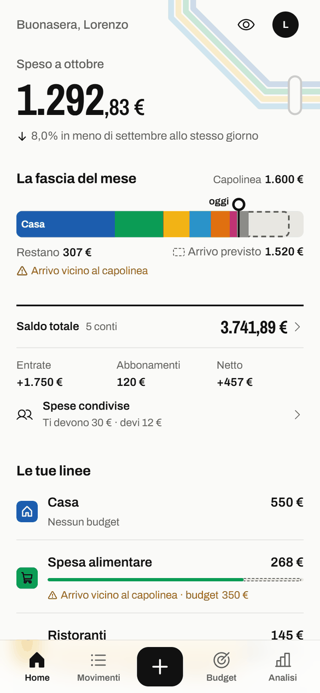
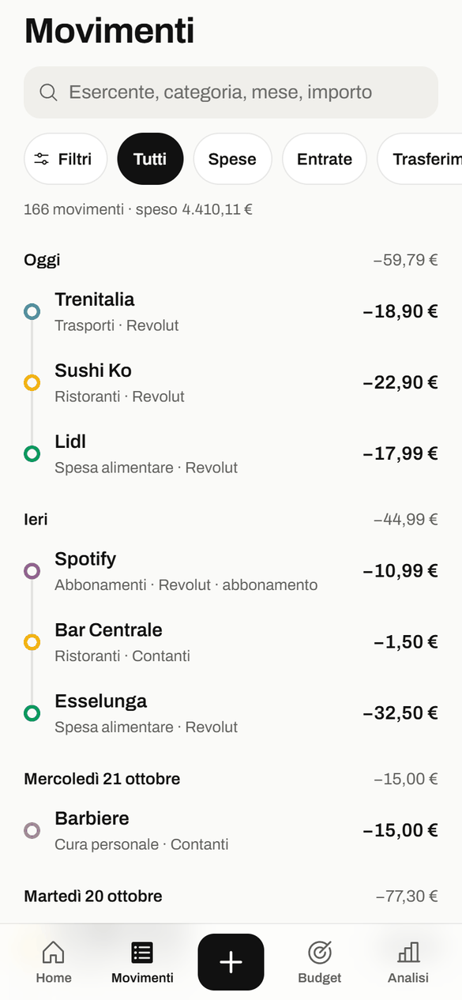
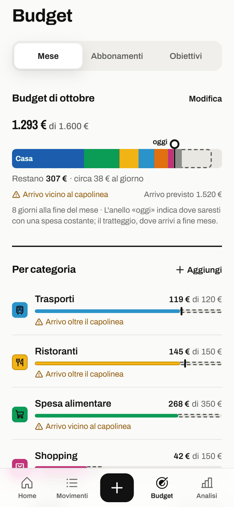
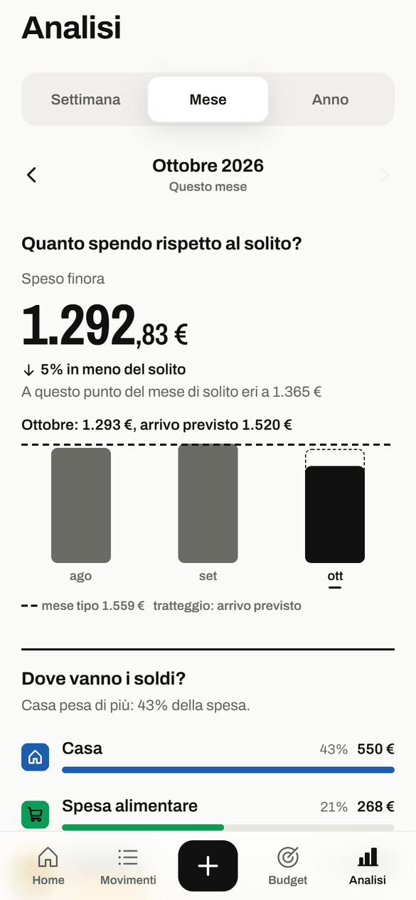

# Capolinea


**Le tue spese, linea per linea.**

App personale per tenere le spese. I dati restano sul telefono, cifrati: niente account, niente server, niente pubblicità. La privacy è attiva di serie.

*In English: Capolinea is an offline personal finance tracker for Android, in Italian. Your data stays on the phone in an encrypted database; the app has no account, no server and no network permission. Licensed under GPL-3.0.*

> **Stato: fase 2, in uso tutti i giorni su Android.** Su iPhone e iPad si prova con Expo Go, ma non c'è ancora un'installazione stabile.

<p>




</p>

*Schermate con i dati di esempio dell'anteprima.*

La direzione visiva si chiama **Linea** e riprende la metropolitana di Milano:

- ogni categoria è una linea colorata;
- i movimenti sono fermate;
- il budget è il capolinea;
- il rosso compare solo oltre il capolinea.

## Cosa fa

- **Spese, entrate, giroconti e rimborsi**, con categorie, conti e note.
- **Budget del mese** per categoria, con la previsione di dove arrivi a fine mese.
- **Abbonamenti** che si segnano da soli il giorno dell'addebito.
- **Spese condivise:** dividi una spesa e tieni il conto di chi deve cosa.
- **Obiettivi di risparmio** con i versamenti.
- **Analisi** per settimana, mese e anno, per categoria e per esercente.
- **Notifiche locali:** addebiti in arrivo, budget quasi finito o superato, riepiloghi. Con la privacy attiva non mostrano cifre.
- **Esportazione** in CSV e **backup completo** in JSON, da ripristinare su un altro telefono.

## Installarla su Android

1. Scarica `capolinea-<versione>.apk` dalle [Release](https://github.com/LorenzoLubrano/capolinea/releases).
2. Controlla che il file sia quello pubblicato: la sua impronta SHA-256 è scritta nella release.
   - Windows: `certutil -hashfile capolinea-1.0.0.apk SHA256`
   - macOS e Linux: `sha256sum capolinea-1.0.0.apk`
3. Apri il file sul telefono e consenti l'installazione da questa fonte.

L'APK è firmato con un certificato la cui impronta SHA-256 è
`a4d11f2eeb45c8d5386b3d8a5ab4114f622fd7f9b81dbbd68c750ffe5f3afb77`.
Gli aggiornamenti si installano sopra solo se sono firmati con lo stesso certificato, e così i dati restano.

**Cambiare telefono:** i dati non vanno nel backup di Google e non passano al telefono nuovo da soli, perché la chiave del database resta sul telefono vecchio. Usa **Profilo › Esporta e backup › Backup completo** e, sul telefono nuovo, **Ripristina da un backup** al primo avvio.

## Privacy e sicurezza

- **Nessuna rete:** l'APK non ha il permesso di usare internet, quindi è Android stesso a impedire che i dati escano.
- **Database cifrato** con SQLCipher. La chiave è fatta di 32 byte casuali, sta nell'archivio sicuro del telefono e non lo lascia mai.
- **Niente backup automatici:** il backup su Google Drive e il passaggio a un telefono nuovo sono esclusi.
- **PIN:**
  - è salvato come hash SHA-256 con sale, nell'archivio sicuro;
  - dal quinto tentativo sbagliato l'attesa cresce, da 30 secondi fino a 15 minuti, anche se chiudi l'app;
  - si può sbloccare anche con volto o impronta, solo se il telefono li considera sicuri (su Android spesso solo l'impronta);
  - è il blocco dell'app, non la cifratura dei dati: non usare lo stesso PIN del telefono o della carta.
- **Link dall'esterno:** l'app non apre nessuna schermata da un link `capolinea://`, così nessuno passa oltre il blocco.
- **Modalità privacy:** nasconde gli importi, anche a TalkBack e VoiceOver.
- **Notifiche:** senza cifre, a meno che tu non scelga «Mostra le cifre» in Impostazioni › Notifiche. Sono private: se il telefono è impostato per nascondere il contenuto sensibile sulla schermata di blocco, mostrano solo che ha scritto Capolinea.
- **Copri l'anteprima:** l'app appare vuota nel multitasking e blocca le catture di schermo.
- **Esportazioni:** il CSV e il backup si condividono e la copia temporanea si cancella all'avvio successivo. Un backup viene controllato campo per campo prima di ripristinarlo.
- **Permessi:**
  - impronta;
  - notifiche, con il ripristino degli allarmi dopo il riavvio;
  - vibrazione;
  - il rilevamento delle catture di schermo, che serve a «Copri l'anteprima».

  Niente rete, archivio, foto, posizione o contatti.
- **Segreti:** nessuna chiave né credenziale nel codice.

Per segnalare un problema di sicurezza vedi [SECURITY.md](SECURITY.md).

## Sviluppo

Serve Node.js in versione LTS (provato con la 24).

```bash
npm install
npx expo start        # poi Expo Go per l'SDK 57 sul telefono, oppure «w» per il browser
npm test              # test (Jest)
npm run typecheck     # TypeScript
npm run lint          # ESLint
```

- **Expo Go:** va bene per provare, ma lì il database **non è cifrato** (Expo Go non include SQLCipher): usalo solo con dati di prova.
- **Browser:** utile per guardare le schermate; i dati restano in memoria e alcune cose esistono solo sul telefono, come la biometria, le notifiche e le vibrazioni.
- **Librerie:** si aggiungono con `npx expo install <pacchetto>`, che sceglie la versione adatta all'SDK.

### Pannello prototipo

Solo nelle build di sviluppo, da **Profilo › Info › Pannello prototipo**:

- **Dati di esempio:** pieni, senza entrate, casi limite, oppure quindici anni di movimenti per misurare la velocità.
- **Data di oggi:** una data finta, per provare inizio e fine mese.
- **Lentezza ed errori:** letture lente o che falliscono.
- **Rivedi il primo avvio.**

In una build di rilascio il pannello non esiste.

### Compilare l'APK

Serve, oltre a Node:

- JDK 21;
- Android SDK con build-tools 36. NDK e CMake li scarica Gradle al primo giro.

La firma usa una chiave tua, fuori dal progetto: per impostazione predefinita in `~/.android-keys`, oppure nella cartella indicata da `ANDROID_KEYS`. Lì serve un `keystore.properties` così:

```properties
storeFile=la-tua-chiave.jks
storePassword=...
keyAlias=...
keyPassword=...
```

Poi:

```bash
bash scripts/build-apk.sh
```

Lo script:
1. rigenera la cartella `android/` (non va modificata a mano);
2. compila per arm64;
3. firma con la tua chiave;
4. scrive `dist/capolinea-<versione>.apk` con la sua impronta.

Le password arrivano al firmatario dall'ambiente, non dalla riga di comando.

## Com'è fatto

- **Stack:**
  - Expo SDK 57, React Native 0.86 e React 19.2 con il React Compiler;
  - TypeScript strict;
  - Expo Router per la navigazione;
  - Reanimated 4 per le animazioni;
  - TanStack Query per i dati e zustand per lo stato.
- **Dati:**
  - expo-sqlite con SQLCipher;
  - migrazioni con `PRAGMA user_version`, ognuna preceduta da una copia cifrata del database.
  - Gli stessi test di contratto girano sul database in memoria e su SQLite (`node:sqlite` in Jest).
- **Importi:** sempre in centesimi interi, mai in virgola mobile.
- **Testi:** tutti in [src/i18n/it.ts](src/i18n/it.ts).

| Cartella | Cosa contiene |
|---|---|
| `src/app/` | Le rotte: ogni file è una schermata, i `_layout.tsx` sono i navigatori |
| `src/domain/` | Logica pura e testata: date, importi, budget e previsione, abbonamenti, divisioni, obiettivi, analisi, blocco |
| `src/data/` | Repository (SQLite sul telefono, memoria sul web), schema e migrazioni, cifratura, dati di esempio |
| `src/features/` | Le schermate, divise per area: home, add, transactions, budget, analytics, money, settings, onboarding, security, notifications |
| `src/components/` | Componenti condivisi: linee, fermate, cifre, chip, fogli, avvisi |
| `src/theme/` | Token di colore, tipografia, spaziatura, movimento |
| `src/services/` | Archivio del telefono, notifiche, formati, accessibilità, sicurezza, file |
| `src/state/` | Stato dell'app: impostazioni, blocco, filtri |
| `plugins/` | Plugin di configurazione Android: niente backup, niente rete nella build di rilascio |

Il sistema visivo è descritto in [DESIGN.md](DESIGN.md), il prodotto in [PRODUCT.md](PRODUCT.md) e le decisioni prese in [docs/decisioni.md](docs/decisioni.md).

## Licenza

[GPL-3.0-only](LICENSE). Le librerie usate hanno licenze permissive: Expo e React Native MIT, SQLCipher BSD, i caratteri Archivo SIL OFL 1.1, le icone Phosphor MIT.
